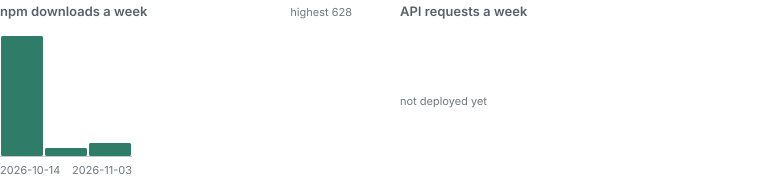

# mihrab-methods

[](https://www.npmjs.com/package/mihrab-methods)
[](https://pypi.org/project/mihrab-methods/)
[](https://github.com/MihrabHQ/mihrab-methods/actions/workflows/ci.yml)
[](https://github.com/MihrabHQ/mihrab-methods/actions/workflows/feed.yml)
[](#usage)
[](#how-verification-works)

**Prayer times that match the published timetable to the printed minute.**
Each authority's own calculation method — a ministry's, a muftiate's, a
council of scholars' — worked out again from its published times and
checked day by day against its timetables: <!--fig:total.off-->0<!--/fig--> of
<!--fig:total.times-->77,611,121<!--/fig--> times off the printed minute. Free for any app, site or
mosque to use.

[](#usage)

```sh
npm install mihrab-methods
```

```ts
import { nearestPlace, timesFor } from 'mihrab-methods/diyanet'; // one authority's data, or 'mihrab-methods' for all

const { place } = nearestPlace('diyanet', 41.01, 28.98)!;  // Istanbul's district
const day = timesFor(place, '2026-10-15');                  // or { year: 2026, month: 10, day: 15 }
day.status;          // 'certified': inside the dates the method was checked over
day.clock.label;     // 'Europe/Istanbul': the clock the table prints the day in
day.times!.fajr;     // { instant: Date, printed: 'HH:MM' } — show printed, schedule on instant
day.certifiedUntil;  // the last date checked; past it, status is 'method-only'
```

Or over HTTP, with nothing to install: the times at a point, from the
authority that publishes for it.

```
GET https://mihrab-api.elghamri.se/v1/times?lat=30.04&lng=31.24&date=2026-10-15
```

Free to call, with no key and nothing logged, and run without a promise of
availability: an app people rely on should carry the library. The routes
are described in [docs/openapi.json](docs/openapi.json); the full API, the
HTTP server and the per-authority imports are in
[docs/usage.md](docs/usage.md).

In Python the same methods and correction lists are on
[PyPI](https://pypi.org/project/mihrab-methods/), with nothing beyond the
standard library:

```sh
pip install mihrab-methods
```

```python
from mihrab_methods import load_corrections, times_for

lists = load_corrections()
stockholm = {'authority': 'sweden', 'lat': 59.33, 'lon': 18.034, 'tz': 'Europe/Stockholm'}
times_for(stockholm, '2026-11-12', lists['sweden'])['printed']   # the six times as 'HH:MM'
```

Swift, Kotlin and Dart ports are in [ports/](ports/README.md); every port
is held to the same test vectors as the library on every push.

## What is certified

<!-- certification-table:start -->
| Authority | Tables matched | Places | Times checked | Off the printed minute | By the method alone | Correction entries | Checked over |
|---|---|---:|---:|---:|---:|---:|---|
| **Sweden** | Islamiska Förbundet’s tables | 107 | 63,114 | **0** | 99.968 % | 270 | 11 Oct 2026 → 14 Dec 2027 |
|  | Diyanet’s own tables | 159 | 1,393,794 | **0** | 99.981 % |  | 1 Jan 2024 → 31 Dec 2027 |
| **Diyanet** | its tables worldwide | 8,318 | 71,630,078 | **0** | 99.987 % | 9,101 | 1 Jan 2024 → 31 Dec 2027 |
| **Morocco** | Habous | 164 | 94,350 | **0** | 99.885 % | 108 | 27 Aug 2026 → 30 Nov 2026 |
| **Algeria** | Ministry of Religious Affairs | 68 | 101,184 | **0** | 99.365 % | 642 | 1 Oct 2026 → 5 Jun 2027 |
| **Indonesia** | Kemenag | 517 | 362,934 | **0** | 99.935 % | 234 | 7 Oct 2026 → 31 Jan 2027 |
| **Türkiye Takvimi** | its cities’ years | 821 | 1,812,768 | **0** | 99.952 % | 860 | 31 Dec 2025 → 2 Jan 2027 |
| **Kazakhstan** | the Spiritual Administration’s times | 84 | 551,880 | **0** | 100.000 % | 0 | 1 Jan 2025 → 31 Dec 2027 |
| **Egypt** | the Survey Authority’s times | 77 | 168,630 | **0** | 99.373 % | 1,056 | 1 Jan 2026 → 31 Dec 2026 |
| **Brunei** | the Ministry’s times | 4 | 17,064 | **0** | 99.671 % | 56 | 9 Jan 2025 → 31 Dec 2026 |
| **Qatar** | the Calendar House’s times | 1 | 708 | **0** | 96.186 % | 27 | 16 Jun 2026 → 11 Oct 2026 |
| **Kuwait** | the Ministry’s table | 46 | 201,480 | **0** | 95.205 % | 9,660 | 1 Jan 2026 → 31 Dec 2027 |
| **Jordan** | the Ministry’s times | 17 | 37,230 | **0** | 98.380 % | 603 | 1 Jan 2026 → 31 Dec 2026 |
| **Tatarstan** | the Administration’s timetable | 44 | 96,360 | **0** | 98.071 % | 1,858 | 1 Jan 2026 → 31 Dec 2026 |
| **Russia (Central Muftiate)** | the Central Muftiate’s timetables | 18 | 39,342 | **0** | 99.877 % | 48 | 1 Jan 2026 → 31 Dec 2026 |
| **Albania** | the Community’s calendar | 22 | 48,180 | **0** | 98.082 % | 924 | 1 Jan 2026 → 31 Dec 2026 |
| **Bulgaria** | the Grand Mufti’s Office’s timetable | 48 | 105,120 | **0** | 97.671 % | 2,448 | 1 Jan 2026 → 31 Dec 2026 |
| **Pakistan (Banuri Town)** | Jamia Banuri Town’s timetable | 100 | 219,000 | **0** | 99.996 % | 8 | 1 Jan 2026 → 31 Dec 2026 |
| **United Arab Emirates** | the Authority’s times | 41 | 179,580 | **0** | 98.221 % | 3,036 | 1 Jan 2026 → 31 Dec 2027 |
| **Iran (Tehran Institute of Geophysics)** | the Institute of Geophysics’ sheets | 31 | 90,520 | **0** | 99.002 % | 903 | 21 Mar 2025 → 20 Mar 2027 |
| **United Kingdom (Wifaqul Ulama)** | Wifaqul Ulama’s timetables | 81 | 350,400 | **0** | 98.625 % | 4,641 | 1 Jan 2026 → 31 Dec 2027 |
| **Tunisia** | the Institute’s times | 26 | 47,405 | **0** | 97.782 % | 1,051 | 1 Jan 2026 → 31 Dec 2026 |

21 of 21 methods certified; 0 of 77,611,121 times off the printed minute. Last checked 12 November 2026. Generated from [`certification.json`](certification.json) by `scripts/readme.mjs`.
<!-- certification-table:end -->

"By the method alone" is the formula without its correction list. The list
holds the few times the authority's own program puts a fraction of a second
on the other side of a minute's rounding point: a point, a date, a prayer, a
minute either way. Why that can be used freely is in
[docs/legal.md](docs/legal.md); what each method still leaves out is in
[docs/status.md](docs/status.md).

## How verification works

1. **The tables.** For each authority, its own published timetables for
   every place it lists, every day it has published. They are not part of
   this repository and are not redistributed; the check reads them from
   `MIHRAB_TABLES`.
2. **The check.** [`tools/verify.ts`](tools/verify.ts) computes every place on
   every day and compares each of the six times with the printed minute, on
   the clock the table prints that day in. Days the table itself gets wrong
   (another town's times under a name, a previous year's rows) are set aside
   and listed in the record, so each can be judged.
3. **The record.** [`tools/certify.ts`](tools/certify.ts) writes
   [`certification.json`](certification.json): per authority, the tables
   checked, the times, how many are off with and without the correction
   list, the dates, the method's revision and the list's SHA-256. The
   tables are checked again whenever they change and every week, and each
   check that finds a method still at 0 off dates its entry anew.
4. **The gate.** A method is certified only at **0** off. `timesFor` refuses
   an uncertified method, and says `'method-only'` for a date past the
   checked span. Every number on this page, on the Mihrab website and in its
   store listings is generated from that record (`scripts/readme.mjs`).

Times that differ from your mosque's?
[Open a report](https://github.com/MihrabHQ/mihrab-methods/issues/new?template=times-differ.yml)
with the city, the date, the prayer and the printed time.

## Keeping an app current

The record and the correction lists are a feed: an app that computes a
method's revision can take any newer list certified for that revision, with
no release.

```ts
import { fetchLatestCorrections } from 'mihrab-methods/morocco';
const r = await fetchLatestCorrections({ authority: 'morocco' });
// 'current' | 'updated' | 'method-moved' (update the app) | 'uncertified' | 'rejected'
```

It takes a list only for the revision the build computes, only when it is
the list the record names, and only when its SHA-256 matches. Schemas, tags
as fixed addresses and the details: [docs/feed.md](docs/feed.md).

## Usage

<!-- usage:start -->
| | Last 7 days | Last 30 days | Since the first release |
|---|---:|---:|---:|
| npm downloads | 2,407 | 3,345 | 3,345 |
| PyPI downloads | 804 | 804 | 804 (since 2026-11-11) |
| API requests | 1,890 | 1,900 | 1,900 (since 2026-11-04) |

Counts only, to 2026-11-11, updated weekly (`scripts/stats.mjs`, history in [docs/stats.json](docs/stats.json)): npm's public download counts — every install counts, CI and mirrors included — PyPI's for the [Python port](https://pypi.org/project/mihrab-methods/) (pypistats.org, mirrors left out), and Cloudflare's request counts for the API. No addresses, queries or places are recorded anywhere.
<!-- usage:end -->

## More

| | |
|---|---|
| [docs/usage.md](docs/usage.md) | The API, the entry points, the HTTP server, this repository's commands and layout |
| [docs/methods.md](docs/methods.md) | Each method in words and formulas, for ports to other languages; `test/vectors.json` to check one |
| [ports/](ports/README.md) | The methods in Python ([on PyPI](https://pypi.org/project/mihrab-methods/)), Swift, Kotlin and Dart, each held to `test/vectors.json` |
| [docs/status.md](docs/status.md) | Per method: what is certified, what was set aside, what is not yet covered |
| [docs/diyanet.md](docs/diyanet.md) | What Diyanet's worldwide tables add: Isha by country, midsummer, Türkiye's points, tables on their own clocks |
| [docs/feed.md](docs/feed.md) | `certification.json` and the lists as a feed: schemas, hashes, revisions, tags |
| [docs/legal.md](docs/legal.md) | Formulas and correction lists: why this can be used freely |
| [CONTRIBUTING.md](CONTRIBUTING.md) | Adding an authority: 100 % or nothing |
| [CHANGELOG.md](CHANGELOG.md) | Each version, and what each method revision changed in the output |

The Mihrab app computes these methods on the phone; a method that improves
here goes back as the same file in Mihrab's `src/providers/`.

Mihrab and this library are independent: not affiliated with, endorsed by
or speaking for any of the authorities whose published timetables they
match.

## Licence

[MPL-2.0](LICENSE). Use the library in any app, open or closed, on a phone
or on a server; what the licence asks is that changes to *these files* — a
method fitted closer to its table, a corrected point — are published under
the same terms, so an improvement to a method reaches everyone. The Mihrab
app stays AGPL-3.0 and includes this library as the MPL allows. Versions
before 1.0.0 were AGPL-3.0-or-later.
